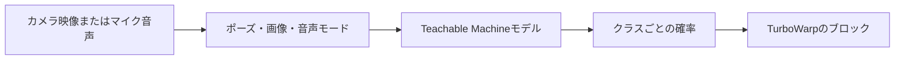

# TurboWarp Teachable Machine


[English](README.md) | [日本語](README.ja.md)

公開済みの[Teachable Machine](https://teachablemachine.withgoogle.com/)のポーズ・画像・音声モデルを、TurboWarpプロジェクトの入力として使うための機能拡張です。カメラの各フレームやマイクの各区間が、スクリプトからそのまま使えるラベル・信頼度・真偽条件になります。

**利用ガイド:** [English](https://kubohiroya.github.io/turbowarp-teachable-machine/) | [日本語](https://kubohiroya.github.io/turbowarp-teachable-machine/ja/) · **[ブロック一覧](#ブロック)**

## できること



- 公開済みのTeachable Machineのポーズ・画像・音声モデルを、モデルフォルダーのURLから読み込む
- 入力を開始する前に、認識モードを`pose`・`image`・`audio`から選ぶ
- カメラの開始・停止を、認識の開始・停止とは独立に制御する
- ステージ上にカメラプレビューを置く（6か所の位置、不透明度、左右反転を設定可能）
- プレビュー上に、ポーズの関節と骨をSVGで重ねて描く（任意）
- 最有力のラベル、その信頼度、任意の名前のクラスの信頼度を返す
- 既定またはプロジェクトごとのしきい値で、ラベルが成立しているかを判定する
- 時間減衰する蓄積スコアで、ぶれやすい判定をなめらかにする
- 起動にかかった時間と、直近の実行時エラーを返す

認識はブラウザー内で完結します。カメラ映像やマイク音声がアップロードされることはなく、取得するのは実行時ライブラリーと公開済みモデルだけです。

## 動作条件

- 公開済みのTeachable Machineのポーズ・画像・音声モデルのURL（エディターのURLではなく、モデルフォルダーのURL）
- カメラまたはマイクと、ブラウザーでのその使用許可
- Teachable Machineのブラウザー実行環境とモデルファイルを取得するためのネットワーク接続
- TurboWarpの**サンドボックスなしで実行**オプション。これはファイルから読み込んだ場合にのみ選べます（[導入方法](#導入方法)を参照）

> [!IMPORTANT]
> この機能拡張は、カメラ・マイク・ステージにアクセスするためサンドボックスなしで動作します。信頼できる提供元のコードだけを読み込んでください。またカメラAPIには、HTTPSや`localhost`などの安全なブラウザーコンテキストが必要です。

## 導入方法

[`dist/tm.js`](dist/tm.js)をダウンロードし、TurboWarpのカスタム機能拡張ダイアログで**ファイル**タブを開いてそのファイルを選び、**サンドボックスなしで実行**を有効のままにしてください。

> [!IMPORTANT]
> ダイアログの**URL**タブからは読み込めません。信頼されていないURLから読み込まれた機能拡張をTurboWarpは常にサンドボックス内で実行し、URLタブには**サンドボックスなしで実行**の選択肢自体がありません。この機能拡張はサンドボックス内では起動を拒否します。下のjsDelivrのリンクをURLタブに貼ると、ダイアログは何も表示しないまま待ち続け、ブラウザーのコンソールに`TM must run without the extension sandbox.`とだけ出ます。ファイルをダウンロードして**ファイル**タブから読み込んでください。

ダウンロード先、および合成ランタイムが取得する成果物は、jsDelivr上のバージョン固定ビルドです。

```text
https://cdn.jsdelivr.net/npm/@kubohiroya/turbowarp-teachable-machine@4.0.0/dist/tm.js
```

合成ランタイムは、縮小済みの第三者バンドルを書き換えることなく、同じ検証済み成果物を読み込んだり同梱したりできます。

```text
https://cdn.jsdelivr.net/npm/@kubohiroya/turbowarp-teachable-machine@4.0.0/dist/runtime.js
```

公開済みパッケージを別のプロジェクトに追加するには次のようにします。

```sh
pnpm add --save-exact @kubohiroya/turbowarp-teachable-machine@4.0.0
```

### 名前について

Scratchの機能拡張IDは、4.x系以降`kubohiroyateachablemachine`です。この系統の他の機能拡張と同じく製品名を綴り切る形に揃えたもので、パッケージ名・リポジトリ名・PagesのURL・ブラウザー向けビルドはいずれも`turbowarp-teachable-machine`を使います。

> **機能拡張IDは4.0.0で変わりました。** メジャー系統ごとに異なるIDを使っています。1.x系までは`tmpose`、2.x系と3.x系は`kubohiroyatm`、4.0.0以降は`kubohiroyateachablemachine`です。4.x系のビルドは新しいIDだけを登録し、古いIDを読み込めるようにするエイリアスは置きません。そのため、それ以前の系統で保存したプロジェクトは、変換するまでブロックが見つからない状態で開きます。展開したプロジェクトのソースは[`sb3-toolchain`](https://github.com/kubohiroya/sb3-toolchain)で変換してください。変更内容を先に報告し、`--yes`を付けたときだけ書き込みます。
>
> ```sh
> sb3-toolchain extensions migrate-id SOURCE_DIR --from kubohiroyatm --to kubohiroyateachablemachine
> ```
>
> 2.x系より前のプロジェクトでは`--from tmpose`を指定します。変換に失敗した場合は入力を変更しません。3.x系のリリースは切り戻し先として公開したままです。

> パッケージ・リポジトリ・PagesのURLは、以前は`turbowarp-tm`（`@kubohiroya/turbowarp-tm`、最終公開は3.2.0）という名前でした。CDNのURL、`pnpm add`、`import`の指定子では`turbowarp-teachable-machine`に置き換えてください。

## はじめかた

1. Teachable Machineで`jump`・`card`・`clap`などのクラスを学習させます。
2. モデルを書き出してアップロードし、モデルフォルダーのURLをコピーします。
3. そのURLを`set model URL to [URL]`で設定します。
4. `start recognition`を実行し、カメラまたはマイクの使用を許可して、結果ブロックを読みます。

```text
緑の旗が押されたとき
set model URL to [https://teachablemachine.withgoogle.com/models/.../]
start recognition

ずっと
  もし <label is [jump] with confidence at least [0.75]?> なら
    ...
  end
end
```

`start recognition`は、必要な入力を開始し、必要であれば設定済みのモデルも読み込みます。ポーズモードと画像モードはカメラを、音声モードはマイクを使います。`start camera`や`load model`を別に実行するのは、起動の段階をプロジェクト側で制御したいときだけです。たとえばモデルの準備が整う前にプレビューを見せたい場合や、`model load time (ms)`を読みたい場合です。

## 計算バックエンド

認識はTensorFlow.jsの計算バックエンド上で動きます。`set compute mode to [MODE]`で選び、`active compute backend`で実際に使われているものを確認します。

| モード | 内容 |
|---|---|
| `auto`（既定） | WebGPU・WebGL・WASM・CPUの順に試し、有効化できて検証用の畳み込みを正しく計算できた最初のものを使う |
| `webgpu` | 新しいGPU経路。演算あたりのオーバーヘッドが最も小さい |
| `webgl` | 長く使われてきたGPU経路。この機能拡張が対応するすべてのブラウザーで使える |
| `wasm` | SIMD対応のWebAssemblyカーネル。GPUドライバーが弱い・不安定な環境で安定する |
| `cpu` | 素のJavaScriptカーネル。どこでも正しく動き、最も遅い |

モードの指定はあくまで希望であって、保証ではありません。ブラウザーが提供できない場合は同じ順序での選択に戻り、`active compute backend`に実際に選ばれたものが出て、`last error`が差し替えの理由を説明します。指定したモードを前提にせず、`active compute backend`を読んでください。

TensorFlow.jsは、テンソルを「作成時に有効だったバックエンド」に結びつけます。そのためモードはモデルの読み込み前に確定している必要があります。モードを変えるとURLから読み込んだモデルは解放され、次の`load model`または`start recognition`が新しいバックエンド上で作り直します。認識中、またはホストが用意したモデルが有効な間のモード変更は、解放ではなく拒否になります。

検証済みのブラウザー実行環境にはWebGLとCPUのカーネルが入っています。WebGPUとWebAssemblyは`dist/runtime.js`の隣にある別バンドルで、プロジェクトが実際に使うときだけ取得され、WebAssemblyのバイナリーは同じパッケージの`dist/wasm/`から読み込まれます。いずれも実行環境が公開した唯一のTensorFlow.jsインスタンスに解決されるので、1つのページ上でTensorFlow.jsのコアが二重に動くことはありません。

## 認識結果を読む

| ブロック | 返す値 |
|---|---|
| `current label` | 直近のフレームで最も確率の高いクラス |
| `confidence` | そのクラスの確率（小数第2位に丸め） |
| `confidence of [NAME]` | 名前を指定したクラスの確率 |
| `label is [NAME]?` | そのクラスの信頼度が`0.75`以上かどうか |
| `label is [NAME] with confidence at least [THRESHOLD]?` | しきい値を`0`〜`1`で指定した同じ判定 |

その場の信頼度は反応が速い反面、判定の境目付近では揺れます。学習データの質、照明や音声の状態、被写体の収め方、プロジェクトに合ったしきい値のほうが、この機能拡張側でできることよりも結果を左右します。1フレームの誤認識で判定がひっくり返ってほしくない場合は、しきい値を上げるのではなく[蓄積ポーズスコア](#蓄積ポーズスコア)を使ってください。

## カメラ・プレビューとモデルが見ているもの

### カメラを選ぶ

`refresh camera list`で映像入力を検出し、`set camera to [CAMERA]`で`default camera`・`front camera`・`back camera`、または検出された個別のデバイスを選びます。ラベルはカメラの使用許可が出るまで空のままのことがあります。デバイスIDはブラウザーと端末に固有なので、プロジェクトを別の端末へ持ち運ぶなら前面／背面の指定のほうが安全です。

カメラ動作中に選択を変えると、カメラストリームだけが再起動し、読み込み済みのモデル・認識状態・プレビュー設定はそのまま保たれます。切り替えに失敗した場合は直前のカメラに戻し、理由を`last error`に記録します。`camera count`・`camera device ID`・`camera device name`は、最後に更新した台数と、現在有効な入力を返します。

### プレビューとモデルへの入力

プレビューは、ステージ上に置かれたカメラ自身のvideo要素で、カメラの解像度とアスペクト比のまま表示されます。表示・非表示、6か所の位置、不透明度、ステージ全面への拡大を設定でき、既定では左右反転しています。`set camera preview to [MIRRORING]`でカメラ動作中も切り替えられます。この反転は表示だけの設定です。

モデルに渡されるのは、フレームの正方形中央切り出しを左右反転したテンソルです。WebGLとWebGPUのバックエンドでは`fromPixels`がvideoを直接テクスチャーへ転送し、切り出しと反転はテンソル演算として行われるので、カメラとモデルの間にCanvas2Dは入りません。正方形であることにより、PoseNetのパディングもゼロになります。

- `stop recognition`は現在の結果を消して音声の待ち受けを止めますが、カメラは使える状態のまま残します。
- `stop camera`は認識も止め、カメラを解放し、プレビューとSVGオーバーレイを取り除きます。

プレビューを隠しても認識は止まりません。

### 1台のカメラを他の機能拡張と共有する

[TurboWarp-Camera-Source](https://github.com/kubohiroya/turbowarp-camera-source)が読み込まれている場合、この機能拡張は自前でデバイスを開かず、Camera Sourceが共有するカメラに`pose`役としてリースを取ります。そうすると1台の物理カメラが、認識と、フレームを読む他の用途（QRコードの読み取り、プレビュー、別の分類器）を同時に賄えます。各機能拡張がデバイスを奪い合うことがなくなります。

ストリームを所有するのはCamera Source側で、最後のリースが解放された時点でカメラを止めます。ここでの`stop camera`は、この機能拡張のリースを解放するだけです。Camera Sourceは必須ではありません。無い場合はこれまでどおり自前でカメラを開閉します。どちらの構成でもプロジェクト側の変更は不要です。

## ポーズオーバーレイ

`poseOverlay`フィーチャーフラグは**既定で有効**なので、オーバーレイ用のブロックは最初からパレットにあります。表示の切り替え、PoseNetの17個の関節それぞれの円の色・不透明度・半径、12本の標準的な骨に共通の色・不透明度・太さ、キーポイントの最小信頼度、信頼度によるスケーリングを設定できます。

オーバーレイのSVG座標系はカメラフレーム自身のものなので、解像度やアスペクト比を問わずカメラに追従し、6か所のプレビュー位置とプレビューの左右反転にも従います。

信頼度によるスケーリングは、関節の不透明度・関節の半径・骨の不透明度・骨の太さごとに独立して切り替えられます。関節の各値はそのキーポイントの信頼度を、骨の各値は両端のうち低いほうの信頼度を掛けた値になります。最小信頼度を下回る端点がある骨は描かれません。いずれも分類器への入力は変えません。

オーバーレイを隠しても認識は止まりません。プレビューを隠すとオーバーレイも隠れ、認識を止めるとすべての描画が消え、カメラを止めるとSVG要素自体が取り除かれます。

## 蓄積ポーズスコア

その場の信頼度は、判定の境目付近でフレームごとに揺れます。蓄積スコアは時間方向に証拠を足し合わせるので、一瞬の誤認識だけで判定が反転することがなくなります。`temporalPoseScoring`フィーチャーフラグは**既定で有効**です。

```text
次のスコア = 前のスコア × 毎秒の減衰率^経過秒数
           + 信頼度 × 毎秒の加算量 × 経過秒数
```

スコアは認識回数ではなく実時間の経過秒数で計算します。加算量は0以上の毎秒の割合、減衰率は1秒後に残る割合で`0`〜`1`に丸められ、変更は次に認識を開始したときから効きます。どちらも、文書が非表示の間は進みません。

`accumulated pose`は、設定したしきい値を満たす場合にのみ最も高い正の蓄積ポーズを返し、満たさない場合は空文字列を返します。スコアのレポーターはしきい値未満でも丸めない値を返し続けます。リセットまたは認識の停止で、すべての蓄積スコアが消えます。

これは候補を1つ選ぶ仕組みです。複数のポーズを順番に待つような処理では、この共有された候補選択をリセットするのではなく、`confidence of [NAME]`を読んで各段階の進行を自前で持ってください。

### 変化イベント

`accumulatedPoseEvents`フィーチャーフラグは**既定で無効**で、`temporalPoseScoring`が必要です。両方を有効にすると、他のサンドボックス外の機能拡張が`runtime.ext_kubohiroyateachablemachine.supportsAccumulatedPoseEvents()`で対応を確認し、TurboWarpランタイム上の`TM_ACCUMULATED_POSE_CHANGED`を購読できます。

バージョン2のイベントは、`poseName`・`previousPoseName`・`score`・`reason`（`recognition`・`reset`・`stop`）と単調増加の`timestamp`を持ちます。イベントが出るのは選ばれた名前が変わったときだけで、リセットや停止で空の名前に移る場合も含みます。スコアだけの更新では何も出ません。

## ホストアプリケーション向けAPI

次の2つの入口は、実行環境を組み込むアプリケーション向けです。TurboWarpのエディターで作るプロジェクトには、どちらも不要です。

### Composition API

`@kubohiroya/turbowarp-teachable-machine/composition`は、標準の機能拡張を登録したりブロックを追加したりせずに、認識エンジンだけを合成ランタイムに提供します。同梱済みのTeachable Machine Poseランタイムと検証済みのモデルバイト列は呼び出し側が渡すので、この経路は実行時スクリプトもモデルファイルもダウンロードしません。

```js
import {createTMComposition} from '@kubohiroya/turbowarp-teachable-machine/composition';

const pose = createTMComposition({
  runtime: bundledTMRuntime,
  compute: tmCompute,                     // dist/runtime.js が公開する
  modelInitializationPolicy: 'latest-needed',
});

const cameras = await pose.listCameraDevices();
if (cameras[0]) await pose.selectCamera({deviceId: cameras[0].deviceId});

await pose.registerPoseModel({
  name: 'RescuePose',
  files: [
    {path: 'model.json', bytes: modelBytes},
    {path: 'weights.bin', bytes: weightsBytes},
    {path: 'metadata.json', bytes: metadataBytes},
  ],
});
pose.activatePoseModel('RescuePose');

pose.setPreviewPosition('full-stage');
pose.setPoseBoneStyle({color: '#00e5ff', opacity: 0.9, width: 3});
pose.configureAccumulatedPose({accumulationPerSecond: 1, decayPerSecond: 0.9, scoreThreshold: 0});
const unsubscribe = pose.subscribeAccumulatedPose((event) => {
  // event.poseName は現在選ばれている候補、または空文字列
});

await pose.startRecognition();
```

**ライフサイクル。** 各コンポジションは、自身のモデルレジストリー・有効なモデル・カメラ・認識状態を所有します。`releasePoseModel(name)`は、そのモデルが有効なら認識を止め、そのモデルだけを破棄します。`releaseAll()`はインスタンス全体を解放し、待機中・実行中の登録処理を取り消し、蓄積ポーズのリスナーを外し、安全に後片付けが終わるまで待ちます。`subscribeAccumulatedPose()`が返す解除関数は冪等です。カメラの取得は独立したライフサイクルで、ストリームを止めるのは`stopCamera()`と`releaseAll()`だけです。`File`オブジェクトは処理中の`loadFromFiles()`の間だけ存在し、レジストリーには保存されません。

**モデル初期化ポリシー。** 既定の`legacy`は、各登録を互いに独立に扱います。`latest-needed`は、場面を飛ばせる物語のように「いま必要なラベルモデルが1つ」というホスト向けです。実行中の重い読み込みは最大1件、待機中の最新要求も1件で、新しい要求は実行中のものを協調的に取り消し、まだ始まっていない古い要求を置き換えます。Aが読み込み中、Bが待機中のところへCが要求された場合、BはTensorFlowのローダーに到達しません。同じ名前・バイト単位で同一のファイル・同じ`AbortSignal`による登録の繰り返しは、1つの処理を共有します。`AbortSignal`が異なれば別の要求のままなので、ある呼び出し側の取り消しが別の呼び出し側の処理を巻き込むことはありません。

その要求がもう不要になったときのために、`registerPoseModel()`には`AbortSignal`を渡せます。待機中の要求はランタイムを呼ばずに`AbortError`で拒否されます。TensorFlow.js 4.22.0とWeb Cryptoは、実行中のすべての処理を物理的に中断できるわけではないので、実行中の要求はただちに「古い」状態になり、以降の段階へは進まず、遅れて得られた分類器とPoseNetの結果をそれぞれちょうど一度だけ破棄してからPromiseを解決します。取り消されたモデルがレジストリーに公開されることはありません。共有されるPoseNetの検証は、次の最新要求でも必要なら、完了してキャッシュされたまま残ることがあります。取り消しでカメラが止まることはありません。

各段階は既定では逐次実行で、TensorFlowの準備完了後・分類器の読み込み後・メタデータの解析後・PoseNetの読み込み後に取り消しを確認します。`parallelModelInitialization: true`は、これらの区切りよりも起動の速さを優先する場合にだけ指定してください。3つの初期化を同時に始めますが、完了してしまった古い資源は取り消しの確定前にすべて破棄されます。

コンポジション側は、場面や動作の到達可能性を推測しません。間近の動作が同じモデルを必要とするならシグナルを保持し、飛ばされた経路に近い需要がないなら中断し、飛ばしたことで需要が変わるなら差し替えのモデルを登録する——その判断はホスト側の責任です。

**カメラ。** `listCameraDevices()`は呼ぶたびにブラウザーの列挙をやり直し、空でない一意の映像デバイスIDだけを列挙順に並べた、深く凍結されたコピーを返します。ラベルは許可が出るまで空のままです。列挙の失敗は`TM-COMPOSITION-012`で、`MediaDeviceInfo`・`MediaStreamTrack`・ストリームを外に出すことはありません。指定は`default`・`front`・`back`という選好か、セッション限りのブラウザーIDを包んだ`{deviceId}`のどちらかです。オブジェクト形式をあえて区別しているので、IDがそのまま`default`であるデバイスが選好と取り違えられることはありません。選択は呼び出し順に処理され、切り替えに失敗すると直前のカメラに戻り、不正な指定は`TM-COMPOSITION-011`になります。デバイスIDは保存されず、解放後は4つのカメラ関連メソッドすべてが安全に失敗します。

**プレビューとオーバーレイ。** `setPreviewOpacity()`は`0`〜`1`、`setPreviewPosition()`は`top-left`・`top-right`・`bottom-left`・`bottom-right`・`center`・`full-stage`、`setPreviewMirroring()`は`mirrored`（既定）か`unmirrored`を取り、カメラ起動の前後や動作中に呼べます。`showPreview()`と`hidePreview()`は表示だけを変えます。オーバーレイは直接有効で、`showPoseOverlay()`・`hidePoseOverlay()`・`isPoseOverlayVisible()`・`setPoseJointStyle()`・`setPoseBoneStyle()`・`setPoseOverlayMinimumConfidence()`・`setPoseOverlayConfidenceScaling()`が使えます。

**計算バックエンド。** `selectComputeBackend('webgpu')`は`{backend, fallback}`を返し、要求したバックエンドが使えなかった場合は`fallback`が`true`になります。ポーズモデルが登録されている間は`TM-COMPOSITION-018`で拒否されます。それらのテンソルは読み込み時のバックエンドのメモリー上にあるためで、先に解放してください。

**破棄の形。** Teachable Machine Pose 0.8.6は、分類器を`CustomPoseNet.model`、PoseNetを`CustomPoseNet.posenetModel`として公開しますが、最上位の`dispose()`はPoseNetしか解放しません。そのためコンポジションは、有効なモデルをまず認識から切り離したうえで、この2つの公開資源をそれぞれちょうど一度ずつ破棄し、不完全な最上位の破棄関数は呼びません。これらのフィールドを持たない独自ランタイムは、従来どおり最上位の`dispose()`だけという契約を保てます。公式の形の一部しか備えないランタイムは、安全に特定できる資源をすべて試みたうえで`TM-COMPOSITION-009`として拒否されます。

**Canvasについて。** この機能拡張は、Teachable MachineとTensorFlow.jsが使うカメラ用canvasを所有し、通常のCanvas2Dコンテキストを要求します。実機カメラでの計測では、320×240で「1回描いて1回読む」この経路に`willReadFrequently`の効果は再現しませんでした。このヒントは映像の描画自体を重くしうるため採用していません。その結果、CPU推論中にChromeがCanvas2Dの読み戻し警告を出すことがあります。採用を再検討するのは、まさにこの経路で再現可能なベンチマークが得られた場合だけにしてください。

### オフラインPoseNetバンドルAPI

`@kubohiroya/turbowarp-teachable-machine/posenet`は、PoseNet MobileNetV1 0.75／ストライド16の固定マニフェスト、パッケージ資産の指定子、SHA-256検証、サイズ上限付きのBase64プロジェクト記述子、そしてTeachable Machine Pose用のfetchアダプターを提供します。ホストアプリケーションが決めるのは、その明示的な記述子をどこに保存するかだけです。モデルはJSONファイル1つとバイナリーシャード2つのままで、画像・音声・コスチュームに偽装されることはありません。

```js
import {readFile} from 'node:fs/promises';
import {
  createBundledTMRuntime,
  createPoseNetProjectBundleFromLoader,
} from '@kubohiroya/turbowarp-teachable-machine/posenet';

const projectBundle = await createPoseNetProjectBundleFromLoader((file) =>
  readFile(new URL(import.meta.resolve(file.packageSpecifier))),
);

// ブラウザー側のホストは projectBundle を自身のプロジェクトデータ領域に保存できる。
// デコードとハッシュ検証は最初の loadFromFiles() の時点で始まる。
const offlineRuntime = createBundledTMRuntime({runtime: tmPose, projectBundle});
```

モデル一式はちょうど5,082,500バイトです。3つのSHA-256の計算は互いに独立に走り、最初の共有検証は分類器の読み込みと重なります。横取りされたPoseNetのfetchは、検証が成功するまで1バイトも渡しません。以降の要求は検証済みの同じデータを再利用します。改ざん、ファイルの欠落やサイズ不一致、想定外のPoseNetへのネットワーク要求は、いずれも`TM-POSENET-*`のエラーコードで安全側に倒れます。

## うまく動かないとき

まず`last error`を読んでください。よくある原因は、カメラの使用許可を拒否した、公開済みモデルフォルダーのURLではなくモデル*エディター*のURLを設定した、ネットワーク要求が遮断されている、サンドボックス内で読み込まれている、のいずれかです。

サンドボックス内で読み込まれた場合、エディター側には何も出ません。カスタム機能拡張ダイアログがただ待ち続け、ブラウザーのコンソールにだけ`TM must run without the extension sandbox.`と出ます。ダウンロードしたファイルをダイアログの**ファイル**タブから読み込んでください。**URL**タブからは読み込めません。

`start camera`には、ページが一度は操作されていることも必要です。ユーザー操作のないページでブラウザーは`video.play()`を拒否し、`NotAllowedError: play() failed because the user didn't interact with the document first.`として現れます。緑の旗のクリックも操作に数えられるので通常のプロジェクトでは問題になりませんが、自動で認識を開始するパッケージ済みプロジェクトでは、何らかのボタン操作を待つ必要があります。

手順を追った確認方法はガイドにあります:
[English](https://kubohiroya.github.io/turbowarp-teachable-machine/#troubleshooting) ·
[日本語](https://kubohiroya.github.io/turbowarp-teachable-machine/ja/#troubleshooting)

## バージョンごとの注意

### 2.xからの移行

ブロックの構成、Composition API、オフラインPoseNetバンドルAPIは変わっていません。2.xで作ったプロジェクトは、機能拡張のファイルを差し替えればそのまま動きます。新しく増えたブロックは9個で、計算バックエンド用が3個、蓄積ポーズスコア用が6個です。変わったのは同梱される実行環境です。

| | 2.x | 3.0.0 |
|---|---|---|
| TensorFlow.js | 1.3.1 | 4.22.0 |
| Teachable Machine Pose | 0.8.3 | 0.8.6 |
| TensorFlow.js Speech Commands | 0.4.0 | 0.5.4 |
| 計算バックエンド | WebGLのみ | WebGPU・WebGL・WASM・CPUを読み込み時に調停 |

この実行環境は`globalThis.tf`として公開されるので、それを直接読むホストアプリケーションはTensorFlow.jsの1.x APIから4.xへ移ることになります。これがメジャーリリースである理由です。Teachable Machineが書き出したモデルには影響しません。1.x時代のライブラリー向けに書き出されたポーズ・画像・音声モデルは、4.22.0上でもそのまま読み込めて動きます。

既存プロジェクトでの挙動の変化は2点です。

- `set compute mode to`ブロックがない場合、常にWebGLを使うのではなくバックエンドを調停するようになりました。どれが選ばれたかは`active compute backend`が返します。
- 最初の`start camera`または`load model`で取得する実行環境が、2.xより大きくなりました（1.04 MBに対し1.24 MB）。起動の流れを組むときに考慮してください。

### 3.4.1 — カメラのリース

3.4.0では、リース経由での開始が`Webcam canvas does not provide a 2D context`を投げ、認識が始まりませんでした。上流のカメラ補助実装が、読み戻し用canvasをデバイスを開く分岐の中で作っており、要素を渡した場合はその分岐を通らないためです。Camera Sourceを併用する環境では3.4.1以降を使ってください。3.4.0で問題が出ないのは、Camera Sourceが無い場合だけです。

### 3.5.0 — プレビューと切り出し

プレビューが、320×240の読み戻しcanvasを拡大したものではなく、カメラ自身の映像になりました。カメラの解像度とアスペクト比がそのまま出ます。モデルに渡すのも、正方形の中央切り出し全体をテンソルにしたものになりました。以前のcanvasはその上端240行しか保持しておらず、被写体の高さの4分の1がモデルに届いていませんでした。さらに4:3のcanvasは正方形へパディングされていたため、被写体は学習時のフレームより25%ほど小さく写っていました。ブロック・オペコード・Composition APIは変わらず、プロジェクト側の修正も不要です。ただしポーズモデルは、これまで見えていなかった被写体を見ることになります。それがこの変更の目的です。

### 3.5.1 — 画像モードの左右反転

画像モードは、左右反転を指定せずにカメラのvideo要素を`predict`へ渡していました。そのため、Teachable Machineが CSS で左右反転されたプレビューを前提に学習していたのに対し、モデルは反転していない画素を見ていました。見ている範囲はもともとフレームの中央切り出しで、欠けていたのは反転だけです。現在はポーズモードと画像モードが、同じ正方形を同じ向きで受け取ります。ポーズ認識に変更はありません。

## ブロック

全48ブロックの一覧です。各ブロックの引数・既定値・オペコードまで含む完全な一覧は、`src/block-definitions.json`から生成される[英語版README](README.md#blocks)にあります。

### モデルと認識モード

| ブロック | 内容 |
|---|---|
| `Teachable Machine version` | この機能拡張のバージョン |
| `set recognition mode to [MODE]` | `pose`・`image`・`audio`のどれを認識するかを選ぶ |
| `recognition mode` | 現在の認識モード |
| `set model URL to [URL]` | 公開済みモデルフォルダーのURLを設定する |
| `load model` | 設定したURLからモデルを読み込む |
| `model is loaded?` | モデルの読み込みが済んでいるか |

### 計算バックエンドの選択

| ブロック | 内容 |
|---|---|
| `set compute mode to [MODE]` | `auto`・`webgpu`・`webgl`・`wasm`・`cpu`のどれを希望するか |
| `compute mode` | 希望として設定されているモード |
| `active compute backend` | 実際に使われているバックエンド |

### カメラ

| ブロック | 内容 |
|---|---|
| `start camera` | カメラを開始する |
| `stop camera` | 認識も止め、カメラを解放し、プレビューとオーバーレイを取り除く |
| `camera is running?` | カメラが動作中か |
| `refresh camera list` | 映像入力を検出し直す |
| `set camera to [CAMERA]` | 既定／前面／背面、または検出されたデバイスを選ぶ |
| `camera count` | 最後に検出した映像入力の台数 |
| `camera device ID` | 現在有効なカメラのデバイスID |
| `camera device name` | 現在有効なカメラの名前 |

### プレビュー

| ブロック | 内容 |
|---|---|
| `show camera preview` | プレビューを表示する |
| `hide camera preview` | プレビューを隠す（認識は止まらない） |
| `camera preview is visible?` | プレビューが表示されているか |
| `set camera preview opacity to [OPACITY]` | 不透明度を`0`〜`1`で設定する |
| `set camera preview position to [POSITION]` | 6か所の位置から選ぶ |
| `set camera preview to [MIRRORING]` | 表示の左右反転を切り替える |
| `camera preview mirroring` | 現在の左右反転の設定 |

### ポーズオーバーレイ（`poseOverlay`）

| ブロック | 内容 |
|---|---|
| `set pose overlay [VISIBILITY]` | オーバーレイの表示・非表示 |
| `pose overlay is visible?` | オーバーレイが表示されているか |
| `set [PART] joint color [COLOR] opacity [OPACITY] radius [RADIUS]` | 関節ごとの色・不透明度・半径 |
| `set pose bone color [COLOR] opacity [OPACITY] width [WIDTH]` | 骨に共通の色・不透明度・太さ |
| `set pose overlay minimum confidence to [CONFIDENCE]` | 描画する最小の信頼度 |
| `set pose [PROPERTY] confidence scaling [STATE]` | 信頼度によるスケーリングを項目ごとに切り替える |

### 認識と結果

| ブロック | 内容 |
|---|---|
| `start recognition` | 必要な入力を開始し、必要ならモデルも読み込んで認識を始める |
| `stop recognition` | 認識を止める（カメラは使える状態のまま） |
| `recognition is running?` | 認識が動作中か |
| `current label` | 直近のフレームで最も確率の高いクラス |
| `confidence` | そのクラスの確率 |
| `confidence of [NAME]` | 名前を指定したクラスの確率 |
| `label is [NAME]?` | 信頼度が`0.75`以上かどうか |
| `label is [NAME] with confidence at least [THRESHOLD]?` | しきい値を指定した同じ判定 |

### 蓄積ポーズ（`temporalPoseScoring`）

| ブロック | 内容 |
|---|---|
| `set accumulated pose accumulation [ACCUMULATION] decay [DECAY]` | 毎秒の加算量と減衰率 |
| `set accumulated pose threshold [THRESHOLD]` | 候補として採用する最小スコア |
| `reset accumulated pose scores` | 蓄積スコアをすべて消す |
| `accumulated pose` | しきい値を満たす最上位の蓄積ポーズ（無ければ空文字列） |
| `accumulated score` | その蓄積ポーズのスコア |
| `accumulated score of [NAME]` | 名前を指定したクラスの蓄積スコア |

### 計測とエラー

| ブロック | 内容 |
|---|---|
| `camera startup time (ms)` | カメラの起動にかかった時間 |
| `model load time (ms)` | モデルの読み込みにかかった時間 |
| `first recognition time (ms)` | 最初の認識までにかかった時間 |
| `last error` | 直近の実行時エラー |

## 開発

```bash
corepack enable
pnpm install --frozen-lockfile
pnpm check
```

`pnpm check`は、型検査・テスト・本番ビルド・生成ドキュメントの検証・Pagesのリンク検証・配布物の再現性・npmパッケージのドライランをまとめて実行します。ビルドは`dist/tm.js`・`dist/composition.js`・`dist/runtime.js`・`dist/posenet.js`と、`dist/posenet/`以下の3つの生のPoseNetモデル資産を生成します。

[英語版README](README.md#blocks)のブロック一覧は`src/block-definitions.json`から`pnpm docs`で生成されます。生成された節ではなく定義のほうを編集してください。リリースの基準は`package.json`のバージョンです。実行時のレポーターはそこに`-typescript`を付けた値を返し、リリース整合性チェックが、生成されたバンドル・READMEのバージョン固定の例・Pagesのバッジ・リリースタグをその値と揃えます。

### npmへの公開

npmへの公開には、長期間有効な書き込みトークンではなくGitHub Actionsのtrusted publishingを使います。npmのパッケージ設定で、`kubohiroya/turbowarp-teachable-machine`のワークフローファイル`publish-npm.yml`を`npm publish`について信頼する設定にしてください。注釈付きのリリースタグとGitHub Releaseを作ったうえで、そのタグを指定して**Publish npm package**を起動します。ワークフローはタグをチェックアウトし、`package.json`と完全に一致することを確認し、すべてのチェックを実行してから、短命のOIDC資格情報で公開します。自動化を戻したい場合は、npmのパッケージ設定からtrusted publisherを外してください。リポジトリーに書き込みトークンを追加しないでください。

## 外部ライブラリー

バージョン固定の`dist/runtime.js`は、TensorFlow.js 4.22.0、Teachable Machine Pose 0.8.6、Teachable Machine Image 0.8.5、TensorFlow.js Speech Commands 0.5.4、PoseNet 2.2.2を、1つの検証済みモジュールグラフとして同梱しています。ランタイムが注入されない場合、標準の機能拡張はこの単一の成果物をjsDelivrから読み込みます。任意の`dist/backend-wasm.js`と`dist/backend-webgpu.js`は、その実行環境がすでに公開したインスタンスに対してTensorFlow.jsを解決するので、1つのページでTensorFlow.jsのコアが二重になることはありません。`dist/wasm/`以下のWebAssemblyバイナリーと、`dist/posenet/`以下の固定オフラインPoseNetモデルデータは、元のバイナリーファイルのまま配布されます。

第三者ライセンスは[THIRD_PARTY_NOTICES.md](THIRD_PARTY_NOTICES.md)にまとめてあります。

## 固定入力の編集

既定OFFの固定入力フォームと既存データの保持規則は[固定入力エディターの契約](docs/fixed-input-editors.ja.md)を参照してください。

## ライセンス

MPL-2.0
