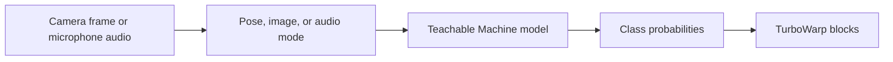

# TurboWarp Teachable Machine


[English](README.md) | [日本語](README.ja.md)

Use a published [Teachable Machine](https://teachablemachine.withgoogle.com/) pose, image, or audio
model as an input for TurboWarp projects. Every camera frame or microphone window becomes a label, a
confidence score, and Boolean conditions that Scratch-style scripts can act on.

**User guide:** [English](https://kubohiroya.github.io/turbowarp-teachable-machine/) | [日本語](https://kubohiroya.github.io/turbowarp-teachable-machine/ja/) · **[Block reference](#blocks)**

## What it does



- Loads a published Teachable Machine pose, image, or audio model from its model folder URL.
- Switches recognition between `pose`, `image`, and `audio` before the input starts.
- Starts and stops the camera independently from recognition.
- Places a camera preview over the stage, at six positions, with adjustable opacity and mirroring.
- Draws an optional SVG overlay of pose joints and bones on that preview.
- Reports the best label, its confidence, and the confidence of any named class.
- Tests a label against a fixed or custom confidence threshold.
- Smooths flickering decisions with time-decayed accumulated scores.
- Reports startup timings and the last runtime error.

Recognition runs in the browser. Camera frames and microphone audio are never uploaded; only the
runtime libraries and the published model are fetched.

## Requirements

- A published Teachable Machine pose, image, or audio model URL — the model folder URL, not the
  editor URL.
- A camera or microphone, and browser permission to use it.
- Network access for the reviewed Teachable Machine browser runtime and the model files.
- TurboWarp's **Run without sandbox** option, which only exists when the extension is loaded from a
  file. See [Installation](#installation).

> [!IMPORTANT]
> This extension is unsandboxed because it needs camera, microphone, and stage access. Load
> extension code only from sources you trust. Camera APIs also require a secure browser context
> such as HTTPS or `localhost`.

## Installation

Download [`dist/tm.js`](dist/tm.js). In TurboWarp's custom extension dialog, open the **Files** tab,
select that file, and keep **Run without sandbox** enabled.

> [!IMPORTANT]
> The dialog's **URL** tab cannot load this extension. TurboWarp always sandboxes an extension
> loaded from an untrusted URL — the URL tab has no **Run without sandbox** option at all — and this
> extension refuses to start sandboxed. Pasting the jsDelivr link below into the URL tab leaves the
> dialog waiting with nothing on screen and only `TM must run without the extension sandbox.` in the
> browser console. Download the file and use the **Files** tab.

The download, and the artifact a composite runtime fetches, is the version-pinned build on jsDelivr:

```text
https://cdn.jsdelivr.net/npm/@kubohiroya/turbowarp-teachable-machine@3.5.6/dist/tm.js
```

A composite runtime can load or embed the same reviewed artifact without rewriting a minified
third-party bundle:

```text
https://cdn.jsdelivr.net/npm/@kubohiroya/turbowarp-teachable-machine@3.5.6/dist/runtime.js
```

To add the published package to another project:

```sh
pnpm add --save-exact @kubohiroya/turbowarp-teachable-machine@3.5.6
```

### Names

The Scratch extension ID is `kubohiroyatm`, from the 2.x release line onward, so that it does not
collide with other short IDs. The package, repository, Pages URL, and browser build all use
`turbowarp-teachable-machine`.

> The package, repository, and Pages URL were previously named `turbowarp-tm`
> (`@kubohiroya/turbowarp-tm`, last published as 3.2.0). Replace that name with
> `turbowarp-teachable-machine` in CDN URLs, `pnpm add`, and `import` specifiers.

## Quick start

1. Train classes such as `jump`, `card`, or `clap` in Teachable Machine.
2. Export the model, upload it, and copy the model folder URL.
3. Set that URL with `set model URL to [URL]`.
4. Run `start recognition`, allow camera or microphone access, and read a result block.

```text
when green flag clicked
set model URL to [https://teachablemachine.withgoogle.com/models/.../]
start recognition

forever
  if <label is [jump] with confidence at least [0.75]?> then
    ...
  end
end
```

`start recognition` starts the input it needs and loads the configured model when necessary. Pose
and image modes use the camera; audio mode uses the microphone. A separate `start camera` or
`load model` step is only needed when a project wants to control the startup phases itself — for
example to show the preview before the model is ready, or to read `model load time (ms)`.

## Compute backends

Recognition runs on a TensorFlow.js compute backend. `set compute mode to [MODE]` chooses one and
`active compute backend` reports the one actually in use.

| Mode | What it does |
|---|---|
| `auto` (default) | Tries WebGPU, WebGL, WASM, and CPU in that order, keeping the first that activates and computes a verification convolution correctly |
| `webgpu` | Modern GPU path, lowest per-operation overhead |
| `webgl` | The long-standing GPU path, available in every browser this extension supports |
| `wasm` | SIMD WebAssembly kernels; steady on machines with weak or unreliable GPU drivers |
| `cpu` | Plain JavaScript kernels; correct everywhere, and slowest |

A named mode is a preference, not a guarantee. When the browser cannot provide it the same order
takes over, `active compute backend` shows what won, and `last error` explains the substitution.
Read `active compute backend` rather than assuming the requested mode.

TensorFlow.js binds every tensor to the backend that was active when the tensor was created, so the
mode has to be settled before a model loads. Changing the mode therefore releases a model that was
loaded from a URL, and the next `load model` or `start recognition` rebuilds it on the new backend.
Changing the mode during recognition, or while a host-prepared model is active, is refused instead.

The reviewed browser runtime carries the WebGL and CPU kernels. WebGPU and WebAssembly live in
separate bundles next to `dist/runtime.js`, fetched only when a project reaches for them, with the
WebAssembly binaries coming from `dist/wasm/` in this same package. Everything resolves against the
one TensorFlow.js instance the runtime published, so no page ever runs two TensorFlow.js cores.

## Reading results

| Block | Result |
|---|---|
| `current label` | The class with the highest probability in the latest frame |
| `confidence` | That class's probability, rounded to two decimal places |
| `confidence of [NAME]` | The probability of one named class |
| `label is [NAME]?` | Whether the named class has at least `0.75` confidence |
| `label is [NAME] with confidence at least [THRESHOLD]?` | The same test with a custom `0`–`1` threshold |

Live confidence reacts quickly and fluctuates near a decision boundary. Better training data,
lighting or audio quality, framing, and a threshold chosen for the project usually matter more than
anything this extension can do for you. When a decision should survive a single bad frame, use
[accumulated pose scoring](#accumulated-pose-scoring) instead of raising the threshold.

## Camera, preview, and what the model sees

### Choosing a camera

`refresh camera list` detects video inputs. `set camera to [CAMERA]` then selects `default camera`,
`front camera`, `back camera`, or one detected device. Labels may stay empty until the browser
grants camera permission, and device IDs are browser- and machine-specific, so prefer the portable
front/back choices when a project moves between devices.

Changing the selection while the camera runs restarts only the camera stream and preserves the
loaded model, the recognition state, and every preview setting. A failed switch restores the
previous camera and records the reason in `last error`. `camera count`, `camera device ID`, and
`camera device name` report the latest refreshed count and the active input.

### The preview and the model input

The preview is the camera's own video element placed over the stage, at the camera's resolution and
aspect ratio. It can be shown, hidden, moved to six positions, made transparent, or expanded to
fill the stage, and it is mirrored by default — `set camera preview to [MIRRORING]` switches that,
including while the camera runs. Mirroring is display-only.

The model is fed a square centre crop of the frame, mirrored, as a tensor. `fromPixels` uploads the
video to a texture on the WebGL and WebGPU backends and the crop and mirroring are tensor ops, so
no Canvas2D stage sits between the camera and the model. The square also makes PoseNet's padding
zero.

- `stop recognition` clears current results and stops audio listening, but leaves the camera
  available.
- `stop camera` also stops recognition, releases the camera, and removes the preview and the SVG
  overlay.

Hiding the preview does not stop recognition.

### Sharing one camera with other extensions

When [TurboWarp-Camera-Source](https://github.com/kubohiroya/turbowarp-camera-source) is loaded,
this extension takes a lease on the camera it shares under the `pose` role instead of opening a
device of its own. One physical camera then serves recognition and anything else reading frames — a
QR reader, a preview, another classifier — rather than each extension competing for the device.

Camera Source owns the stream: it stops the camera when the last lease is released, and `stop
camera` here releases only this extension's lease. Camera Source is not required; without it the
extension opens and stops its own camera exactly as before, and a project needs no edit either way.

## Pose overlay

The `poseOverlay` feature flag is **on by default**, so the overlay blocks are in the palette:
visibility, per-joint circle colour/opacity/radius for the 17 PoseNet joints, shared bone
colour/opacity/width for the 12 standard connections, a minimum keypoint confidence, and confidence
scaling.

The overlay's SVG coordinate system is the camera frame's own, so it follows a camera of any
resolution or aspect ratio and honours all six preview positions and preview mirroring.

Confidence scaling switches independently for joint opacity, joint radius, bone opacity, and bone
width. A joint property is multiplied by that keypoint's confidence; a bone property by the lower
confidence of its two endpoints. A bone is hidden when either endpoint falls below the minimum
confidence. None of this changes the classifier input.

Hiding the overlay does not stop recognition. Hiding the preview also hides the overlay; stopping
recognition clears every mark; stopping the camera removes the SVG element.

## Accumulated pose scoring

Live confidence flickers frame to frame near a decision boundary. Accumulated scores combine
evidence over time, so a brief misrecognition cannot flip a decision on its own. The
`temporalPoseScoring` feature flag is **on by default**.

```text
nextScore = previousScore × decayPerSecond^elapsedSeconds
          + confidence × accumulationPerSecond × elapsedSeconds
```

Scores use elapsed wall-clock seconds, not recognition counts. The accumulation coefficient is a
per-second rate of zero or more. The decay coefficient is the fraction retained after one second,
clamped to `0`–`1`; a changed decay takes effect the next time recognition starts. Both pause while
the document is hidden.

`accumulated pose` returns the highest positive accumulated pose only when it meets the configured
threshold, and an empty string otherwise; the score reporters keep returning their unrounded values
below it. Resetting or stopping recognition clears every accumulated score.

This chooses one candidate. A consumer that waits for several pose steps in sequence should read
`confidence of [NAME]` and own its own per-step progress rather than resetting this shared
candidate-selection state.

### Change events

The `accumulatedPoseEvents` feature flag is **off by default** and requires `temporalPoseScoring`.
With both enabled, other unsandboxed extensions can check
`runtime.ext_kubohiroyatm.supportsAccumulatedPoseEvents()` and subscribe to
`TM_ACCUMULATED_POSE_CHANGED` on the TurboWarp runtime.

A version 2 event carries `poseName`, `previousPoseName`, `score`, `reason` (`recognition`, `reset`,
or `stop`), and a monotonic `timestamp`. An event is published only when the selected name changes,
including the transition to an empty name on reset or stop; score-only updates publish nothing.

## Host application APIs

These two entry points are for applications that embed the runtime. A project built in the TurboWarp
editor needs neither.

### Composition API

`@kubohiroya/turbowarp-teachable-machine/composition` gives a composite runtime the recognition
engine without registering the standalone extension or adding blocks. The caller supplies an
already-bundled Teachable Machine Pose runtime and validated model bytes, so this path downloads no
runtime script and no model file.

```js
import {createTMComposition} from '@kubohiroya/turbowarp-teachable-machine/composition';

const pose = createTMComposition({
  runtime: bundledTMRuntime,
  compute: tmCompute,                     // published by dist/runtime.js
  modelInitializationPolicy: 'latest-needed',
});

const cameras = await pose.listCameraDevices();
if (cameras[0]) await pose.selectCamera({deviceId: cameras[0].deviceId});

await pose.registerPoseModel({
  name: 'RescuePose',
  files: [
    {path: 'model.json', bytes: modelBytes},
    {path: 'weights.bin', bytes: weightsBytes},
    {path: 'metadata.json', bytes: metadataBytes},
  ],
});
pose.activatePoseModel('RescuePose');

pose.setPreviewPosition('full-stage');
pose.setPoseBoneStyle({color: '#00e5ff', opacity: 0.9, width: 3});
pose.configureAccumulatedPose({accumulationPerSecond: 1, decayPerSecond: 0.9, scoreThreshold: 0});
const unsubscribe = pose.subscribeAccumulatedPose((event) => {
  // event.poseName is the currently selected candidate, or an empty string.
});

await pose.startRecognition();
```

**Lifecycle.** Each composition owns its model registry, active model, camera, and recognition
state. `releasePoseModel(name)` stops recognition when that model is active and disposes only it;
`releaseAll()` releases the whole instance, cancels queued and active registration work, removes
accumulated-pose listeners, and waits for safe cleanup. `subscribeAccumulatedPose()` returns an
idempotent unsubscribe. Camera capture is an independent lifecycle: only `stopCamera()` and
`releaseAll()` stop the stream. `File` objects live only for the pending `loadFromFiles()` call and
are never stored in the registry.

**Model initialization policy.** The default `legacy` policy keeps every registration independent.
`latest-needed` suits a host with one current label-model demand, such as a story that can skip
scenes: at most one heavy load is active and one newest request pending, and a newer request
cancels the active one cooperatively and replaces an older request that has not started. For A
loading, B pending, then C requested, B never reaches the TensorFlow loader. Repeated registrations
with the same name, byte-identical files, and the same `AbortSignal` share one pending operation;
different signals stay separate, so cancelling one caller cannot cancel another's work.

Pass an `AbortSignal` to `registerPoseModel()` when the host no longer needs that demand. A queued
request rejects with `AbortError` without invoking the runtime. TensorFlow.js 4.22.0 and Web Crypto
cannot physically cancel every operation already running, so a running request becomes stale at
once, starts no later phase, and disposes every late classifier and PoseNet result exactly once
before its promise settles. A cancelled model is never published in the registry; shared PoseNet
verification may finish and stay cached. Cancellation never stops the camera.

Phases run sequentially by default, with cancellation checked after TensorFlow readiness,
classifier loading, metadata parsing, and PoseNet loading. Set `parallelModelInitialization: true`
only when startup latency matters more than those boundaries; it starts the three in parallel, and
completed stale resources are still disposed before cancellation settles.

The composition does not infer scene reachability. A host should retain the signal when the model is
needed by an imminent action, abort it when a skipped path has no nearby demand, and submit the
replacement model when a skip changes that demand.

**Cameras.** `listCameraDevices()` enumerates afresh on every call and returns a deeply frozen copy
holding only unique, non-empty video device IDs in enumeration order; labels stay empty until
permission makes them available. Enumeration failures use `TM-COMPOSITION-012` and never expose
`MediaDeviceInfo`, `MediaStreamTrack`, or a stream. Select `default`, `front`, or `back` as a
preference, or wrap a session-only browser ID as `{deviceId}` — the object form is deliberately
distinct, so a device whose ID is literally `default` is not mistaken for the preference. Selections
run in call order; a failed switch restores the preceding camera; invalid selections use
`TM-COMPOSITION-011`. Device IDs are never persisted, and all four camera methods fail closed after
release.

**Preview and overlay.** `setPreviewOpacity()` takes `0`–`1`; `setPreviewPosition()` takes
`top-left`, `top-right`, `bottom-left`, `bottom-right`, `center`, or `full-stage`;
`setPreviewMirroring()` takes `mirrored` (the default) or `unmirrored` and may be called before,
during, or after camera startup. `showPreview()` and `hidePreview()` change visibility only. The
overlay is enabled directly, with `showPoseOverlay()`, `hidePoseOverlay()`,
`isPoseOverlayVisible()`, `setPoseJointStyle()`, `setPoseBoneStyle()`,
`setPoseOverlayMinimumConfidence()`, and `setPoseOverlayConfidenceScaling()`.

**Compute.** `selectComputeBackend('webgpu')` resolves to `{backend, fallback}`, where `fallback`
is `true` when the requested backend was unusable. It is rejected with `TM-COMPOSITION-018` while
pose models are registered, because their tensors live in the memory of the backend that loaded
them — release them first.

**Disposal shape.** Teachable Machine Pose 0.8.6 exposes the classifier as `CustomPoseNet.model`
and PoseNet as `CustomPoseNet.posenetModel`, while its top-level `dispose()` releases PoseNet only.
The composition therefore disconnects an active model from recognition first and disposes those two
public resources separately and exactly once, rather than calling the incomplete top-level
disposer. A custom injected runtime without those fields keeps the legacy single-`dispose()`
contract; a runtime exposing only part of the official shape is rejected with `TM-COMPOSITION-009`
after every safely identifiable resource has been attempted.

**Canvas note.** The extension owns the camera canvas used by Teachable Machine and TensorFlow.js
and requests a normal Canvas2D context for it. Physical-camera measurements of its 320×240,
one-draw/one-read path showed no repeatable benefit from `willReadFrequently`, and that hint can
make video drawing more expensive, so Chrome may emit its Canvas2D readback warning during CPU
inference. Reconsider the hint only with a reproducible benchmark of this exact path.

### Offline PoseNet bundle API

`@kubohiroya/turbowarp-teachable-machine/posenet` owns the fixed PoseNet MobileNetV1 0.75 /
stride 16 manifest, the package asset specifiers, SHA-256 verification, a bounded Base64 project
descriptor, and the Teachable Machine Pose fetch adapter. A host application only decides where
that explicit descriptor is stored. The model stays one JSON file and two binary shards; it is
never disguised as an image, sound, or costume.

```js
import {readFile} from 'node:fs/promises';
import {
  createBundledTMRuntime,
  createPoseNetProjectBundleFromLoader,
} from '@kubohiroya/turbowarp-teachable-machine/posenet';

const projectBundle = await createPoseNetProjectBundleFromLoader((file) =>
  readFile(new URL(import.meta.resolve(file.packageSpecifier))),
);

// A browser host can store projectBundle in its own project-data channel.
// Decoding and hash verification start on the first loadFromFiles() call.
const offlineRuntime = createBundledTMRuntime({runtime: tmPose, projectBundle});
```

The model supply is exactly 5,082,500 bytes. Its three SHA-256 operations run independently, and the
first shared verification overlaps the classifier load. The intercepted PoseNet fetch exposes no
bytes until verification succeeds, and later requests reuse the same verified supply. Tampering,
missing or wrongly sized files, and unexpected PoseNet network requests all fail closed with
`TM-POSENET-*` error codes.

## Troubleshooting

Read `last error` first. The usual causes are denied camera permission, a model *editor* URL instead
of the published model folder URL, blocked network requests, and a sandboxed load.

A sandboxed load shows nothing in the editor: the custom extension dialog simply keeps waiting, and
only the browser console carries `TM must run without the extension sandbox.` Load the downloaded
file from the dialog's **Files** tab, never from its **URL** tab.

`start camera` also needs the page to have been interacted with at least once. Browsers refuse
`video.play()` without user activation, which surfaces as `NotAllowedError: play() failed because
the user didn't interact with the document first.` Clicking the green flag counts, so an ordinary
project is fine; a packaged project that starts recognition on its own has to wait for a button
press first.

The guide has step-by-step checks:
[English](https://kubohiroya.github.io/turbowarp-teachable-machine/#troubleshooting) ·
[日本語](https://kubohiroya.github.io/turbowarp-teachable-machine/ja/#troubleshooting).

## Version notes

### Upgrading from 2.x

The block surface, the composition API, and the offline PoseNet bundle API are unchanged; a project
built on 2.x keeps working after swapping the extension file. Nine blocks are new — three for
compute backends, six for accumulated pose scoring. What changed is the bundled runtime:

| | 2.x | 3.0.0 |
|---|---|---|
| TensorFlow.js | 1.3.1 | 4.22.0 |
| Teachable Machine Pose | 0.8.3 | 0.8.6 |
| TensorFlow.js Speech Commands | 0.4.0 | 0.5.4 |
| Compute backends | WebGL only | WebGPU, WebGL, WASM, CPU, negotiated at load |

That runtime is published as `globalThis.tf`, so a host application reading it directly moves from
the TensorFlow.js 1.x API to 4.x — the reason this is a major release. Models exported by Teachable
Machine are unaffected: pose, image, and audio models exported for the 1.x-era libraries load and
run unchanged on 4.22.0.

Two behavioural notes for existing projects:

- Without a `set compute mode to` block, recognition now negotiates a backend instead of always
  using WebGL. `active compute backend` reports which one won.
- The first `start camera` or `load model` downloads a larger runtime than 2.x did (1.24 MB against
  1.04 MB), so plan the startup sequence accordingly.

### 3.4.1 — camera leasing

In 3.4.0 a leased start threw `Webcam canvas does not provide a 2D context` and recognition never
began, because the upstream camera helper builds its readback canvas in the same branch that opens
the device — the branch a supplied element skips. Use 3.4.1 or later wherever Camera Source is
loaded; 3.4.0 is unaffected only when it is not.

### 3.5.0 — preview and crop

The preview became the camera's own video rather than a 320×240 readback canvas scaled to fit, so it
carries the camera's resolution and aspect ratio. The model is fed the whole square centre crop as a
tensor; the canvas used to hold only its top 240 rows, so a quarter of the subject's height never
reached the model, and the 4:3 canvas was padded back to square, leaving the subject about 25%
smaller than the frames the model was trained on. Blocks, opcodes, and the composition API are
unchanged — but a pose model now sees a subject it was not seeing before, which is the point.

### 3.5.1 — image-mode mirroring

Image mode handed `predict` the camera's video element without asking for mirroring, so the model
saw unmirrored pixels while Teachable Machine had trained it on a CSS-mirrored preview. The square
it sees was already the frame's centre crop; only the mirroring was missing. Pose and image mode now
feed the same square the same way round. Pose recognition is unchanged.

## Blocks

<!-- BEGIN GENERATED BLOCKS -->

### `Teachable Machine version`

Returns the extension version.

| Property | Value |
|---|---|
| Type | REPORTER |
| Opcode | `versionReporter` |

### `set recognition mode to [MODE]`

Selects whether the current Teachable Machine model recognizes poses, images, or audio.

| Property | Value |
|---|---|
| Type | COMMAND |
| Opcode | `setRecognitionMode` |
| `MODE` | STRING, default: `pose`, menu: `recognitionModeMenu` |

### `recognition mode`

Returns the current recognition mode.

| Property | Value |
|---|---|
| Type | REPORTER |
| Opcode | `recognitionModeReporter` |

### `set compute mode to [MODE]`

Selects the TensorFlow.js compute backend. "auto" negotiates WebGPU, WebGL, WASM, and CPU in that order and falls back automatically when a backend is unusable. Changing the mode releases a model that was loaded from a URL so it can be reloaded on the new backend.

| Property | Value |
|---|---|
| Type | COMMAND |
| Opcode | `setComputeMode` |
| `MODE` | STRING, default: `auto`, menu: `computeModeMenu` |

### `compute mode`

Returns the requested compute mode.

| Property | Value |
|---|---|
| Type | REPORTER |
| Opcode | `computeModeReporter` |

### `active compute backend`

Returns the TensorFlow.js backend recognition is actually running on, which can differ from the requested mode when the browser could not provide it.

| Property | Value |
|---|---|
| Type | REPORTER |
| Opcode | `computeBackendReporter` |

### `set model URL to [URL]`

Sets the Teachable Machine model URL.

| Property | Value |
|---|---|
| Type | COMMAND |
| Opcode | `setModelURL` |
| `URL` | STRING, default: `https://teachablemachine.withgoogle.com/models/XXXX/` |

### `start camera`

Starts the camera and attaches the preview.

| Property | Value |
|---|---|
| Type | COMMAND |
| Opcode | `startCamera` |

### `stop camera`

Stops the camera and recognition loop.

| Property | Value |
|---|---|
| Type | COMMAND |
| Opcode | `stopCamera` |

### `camera is running?`

Reports whether the camera is running.

| Property | Value |
|---|---|
| Type | BOOLEAN |
| Opcode | `isCameraRunning` |

### `refresh camera list`

Refreshes the list of available video input devices.

| Property | Value |
|---|---|
| Type | COMMAND |
| Opcode | `refreshCameraList` |

### `set camera to [CAMERA]`

Selects the default, front, back, or a detected camera and switches a running camera.

| Property | Value |
|---|---|
| Type | COMMAND |
| Opcode | `setCameraSelection` |
| `CAMERA` | STRING, default: `default`, menu: `cameraMenu` |

### `camera count`

Returns the number of video input devices found by the latest refresh.

| Property | Value |
|---|---|
| Type | REPORTER |
| Opcode | `cameraCountReporter` |

### `camera device ID`

Returns the active camera device ID when available.

| Property | Value |
|---|---|
| Type | REPORTER |
| Opcode | `cameraDeviceIdReporter` |

### `camera device name`

Returns the active camera device name when available.

| Property | Value |
|---|---|
| Type | REPORTER |
| Opcode | `cameraDeviceNameReporter` |

### `show camera preview`

Shows the camera preview.

| Property | Value |
|---|---|
| Type | COMMAND |
| Opcode | `showPreview` |

### `hide camera preview`

Hides the camera preview.

| Property | Value |
|---|---|
| Type | COMMAND |
| Opcode | `hidePreview` |

### `camera preview is visible?`

Reports whether the preview is configured as visible.

| Property | Value |
|---|---|
| Type | BOOLEAN |
| Opcode | `isPreviewVisible` |

### `set camera preview opacity to [OPACITY]`

Sets preview opacity from 0 to 1.

| Property | Value |
|---|---|
| Type | COMMAND |
| Opcode | `setPreviewOpacity` |
| `OPACITY` | NUMBER, default: `0.6` |

### `set camera preview position to [POSITION]`

Sets the preview position on the stage.

| Property | Value |
|---|---|
| Type | COMMAND |
| Opcode | `setPreviewPosition` |
| `POSITION` | STRING, default: `bottom-right`, menu: `positionMenu` |

### `set camera preview to [MIRRORING]`

Sets whether the preview is mirrored without changing the recognition input.

| Property | Value |
|---|---|
| Type | COMMAND |
| Opcode | `setPreviewMirroring` |
| `MIRRORING` | STRING, default: `mirrored`, menu: `previewMirroringMenu` |

### `camera preview mirroring`

Returns mirrored or unmirrored for the current preview setting.

| Property | Value |
|---|---|
| Type | REPORTER |
| Opcode | `previewMirroringReporter` |

### `set pose overlay [VISIBILITY]`

Shows or hides the SVG pose overlay without stopping recognition.

| Property | Value |
|---|---|
| Type | COMMAND |
| Opcode | `setPoseOverlayVisibility` |
| Feature flag | `poseOverlay` |
| `VISIBILITY` | STRING, default: `on`, menu: `poseOverlayVisibilityMenu` |

### `pose overlay is visible?`

Reports whether the SVG pose overlay is configured as visible.

| Property | Value |
|---|---|
| Type | BOOLEAN |
| Opcode | `isPoseOverlayVisible` |
| Feature flag | `poseOverlay` |

### `set [PART] joint color [COLOR] opacity [OPACITY] radius [RADIUS]`

Sets the SVG circle style for one PoseNet joint.

| Property | Value |
|---|---|
| Type | COMMAND |
| Opcode | `setPoseJointStyle` |
| Feature flag | `poseOverlay` |
| `PART` | STRING, default: `nose`, menu: `poseKeypointMenu` |
| `COLOR` | STRING, default: `#00e5ff` |
| `OPACITY` | NUMBER, default: `1` |
| `RADIUS` | NUMBER, default: `4` |

### `set pose bone color [COLOR] opacity [OPACITY] width [WIDTH]`

Sets the color, opacity, and line width for all SVG pose bones.

| Property | Value |
|---|---|
| Type | COMMAND |
| Opcode | `setPoseBoneStyle` |
| Feature flag | `poseOverlay` |
| `COLOR` | STRING, default: `#00e5ff` |
| `OPACITY` | NUMBER, default: `0.9` |
| `WIDTH` | NUMBER, default: `3` |

### `set pose overlay minimum confidence to [CONFIDENCE]`

Hides joints and bones whose keypoint confidence is below the given value.

| Property | Value |
|---|---|
| Type | COMMAND |
| Opcode | `setPoseOverlayMinimumConfidence` |
| Feature flag | `poseOverlay` |
| `CONFIDENCE` | NUMBER, default: `0.5` |

### `set pose [PROPERTY] confidence scaling [STATE]`

Scales the selected SVG style property from zero to its configured value using keypoint confidence.

| Property | Value |
|---|---|
| Type | COMMAND |
| Opcode | `setPoseConfidenceScaling` |
| Feature flag | `poseOverlay` |
| `PROPERTY` | STRING, default: `joint-opacity`, menu: `poseConfidencePropertyMenu` |
| `STATE` | STRING, default: `off`, menu: `poseOverlayVisibilityMenu` |

### `load model`

Loads the configured Teachable Machine model.

| Property | Value |
|---|---|
| Type | COMMAND |
| Opcode | `loadModel` |

### `model is loaded?`

Reports whether the model is loaded.

| Property | Value |
|---|---|
| Type | BOOLEAN |
| Opcode | `isModelLoaded` |

### `start recognition`

Starts recognition.

| Property | Value |
|---|---|
| Type | COMMAND |
| Opcode | `startRecognition` |

### `stop recognition`

Stops recognition.

| Property | Value |
|---|---|
| Type | COMMAND |
| Opcode | `stopRecognition` |

### `recognition is running?`

Reports whether recognition is running.

| Property | Value |
|---|---|
| Type | BOOLEAN |
| Opcode | `isRecognizing` |

### `current label`

Returns the highest-scoring label.

| Property | Value |
|---|---|
| Type | REPORTER |
| Opcode | `currentPoseReporter` |

### `confidence`

Returns the confidence of the current label.

| Property | Value |
|---|---|
| Type | REPORTER |
| Opcode | `scoreReporter` |

### `confidence of [NAME]`

Returns the confidence for a named label.

| Property | Value |
|---|---|
| Type | REPORTER |
| Opcode | `poseScoreReporter` |
| `NAME` | STRING, default: `jump` |

### `set accumulated pose accumulation [ACCUMULATION] decay [DECAY]`

Sets the accumulation rate per second and the decay retained per second; decay changes apply to the next recognition session.

| Property | Value |
|---|---|
| Type | COMMAND |
| Opcode | `setAccumulatedPoseParameters` |
| Feature flag | `temporalPoseScoring` |
| `ACCUMULATION` | NUMBER, default: `1` |
| `DECAY` | NUMBER, default: `0.9` |

### `set accumulated pose threshold [THRESHOLD]`

Sets the minimum accumulated score required to report a pose; values below the threshold report an empty string.

| Property | Value |
|---|---|
| Type | COMMAND |
| Opcode | `setAccumulatedPoseThreshold` |
| Feature flag | `temporalPoseScoring` |
| `THRESHOLD` | NUMBER, default: `0` |

### `reset accumulated pose scores`

Clears all accumulated pose scores.

| Property | Value |
|---|---|
| Type | COMMAND |
| Opcode | `resetAccumulatedPose` |
| Feature flag | `temporalPoseScoring` |

### `accumulated pose`

Returns the pose label whose accumulated score is highest and meets the threshold, or an empty string otherwise.

| Property | Value |
|---|---|
| Type | REPORTER |
| Opcode | `accumulatedPoseReporter` |
| Feature flag | `temporalPoseScoring` |

### `accumulated score`

Returns the highest accumulated pose score without rounding.

| Property | Value |
|---|---|
| Type | REPORTER |
| Opcode | `accumulatedScoreReporter` |
| Feature flag | `temporalPoseScoring` |

### `accumulated score of [NAME]`

Returns the accumulated score for a named pose without rounding.

| Property | Value |
|---|---|
| Type | REPORTER |
| Opcode | `accumulatedPoseScoreReporter` |
| Feature flag | `temporalPoseScoring` |
| `NAME` | STRING, default: `jump` |

### `label is [NAME]?`

Reports whether the named label has at least 0.75 confidence.

| Property | Value |
|---|---|
| Type | BOOLEAN |
| Opcode | `isPose` |
| `NAME` | STRING, default: `jump` |

### `label is [NAME] with confidence at least [THRESHOLD]?`

Reports whether the named label meets the given threshold.

| Property | Value |
|---|---|
| Type | BOOLEAN |
| Opcode | `isPoseWithThreshold` |
| `NAME` | STRING, default: `jump` |
| `THRESHOLD` | NUMBER, default: `0.75` |

### `camera startup time (ms)`

Returns camera startup time in milliseconds.

| Property | Value |
|---|---|
| Type | REPORTER |
| Opcode | `cameraMsReporter` |

### `model load time (ms)`

Returns model load time in milliseconds.

| Property | Value |
|---|---|
| Type | REPORTER |
| Opcode | `modelLoadMsReporter` |

### `first recognition time (ms)`

Returns first recognition time in milliseconds.

| Property | Value |
|---|---|
| Type | REPORTER |
| Opcode | `firstRecognitionMsReporter` |

### `last error`

Returns the latest recorded error message.

| Property | Value |
|---|---|
| Type | REPORTER |
| Opcode | `lastErrorReporter` |

<!-- END GENERATED BLOCKS -->

## Development

```bash
corepack enable
pnpm install --frozen-lockfile
pnpm check
```

`pnpm check` runs type checking, tests, the production build, generated-documentation validation,
Pages link validation, distribution reproducibility, and an npm package dry run. The build produces
`dist/tm.js`, `dist/composition.js`, `dist/runtime.js`, `dist/posenet.js`, and the three raw PoseNet
model assets under `dist/posenet/`.

The block reference above is generated from `src/block-definitions.json` by `pnpm docs`; edit the
definitions, not the generated section. The version in `package.json` is the release source of
truth: the runtime reporter appends `-typescript` to it, and the release consistency check keeps the
generated bundles, the exact-version README examples, the Pages badges, and the release tag aligned
with it.

### npm publishing

npm publication uses GitHub Actions trusted publishing rather than a long-lived write token. The npm
package settings must trust `kubohiroya/turbowarp-teachable-machine`, workflow file
`publish-npm.yml`, for `npm publish`. Once the annotated release tag and the GitHub Release exist,
dispatch **Publish npm package** with that tag: the workflow checks out the tag, verifies that it
matches `package.json` exactly, runs the complete check, and publishes through a short-lived OIDC
credential. Roll the automation back by removing the trusted publisher in npm package settings; do
not add a write token to the repository.

## External libraries

The version-pinned `dist/runtime.js` artifact bundles TensorFlow.js 4.22.0, Teachable Machine Pose
0.8.6, Teachable Machine Image 0.8.5, TensorFlow.js Speech Commands 0.5.4, and PoseNet 2.2.2 in one
reviewed module graph. The standalone extension loads that single artifact from jsDelivr when no
runtime is injected. The optional `dist/backend-wasm.js` and `dist/backend-webgpu.js` bundles
resolve TensorFlow.js against the instance that runtime already published, so a page never ends up
with two TensorFlow.js cores. The WebAssembly binaries under `dist/wasm/` and the fixed offline
PoseNet model data under `dist/posenet/` are distributed as their original binary files.

Third-party licences are listed in [THIRD_PARTY_NOTICES.md](THIRD_PARTY_NOTICES.md).

## Fixed input editors

The opt-in fixed input forms, and the rules that keep existing data intact, are described in
[the fixed input editor contract](docs/fixed-input-editors.ja.md) (Japanese).

## License

MPL-2.0
